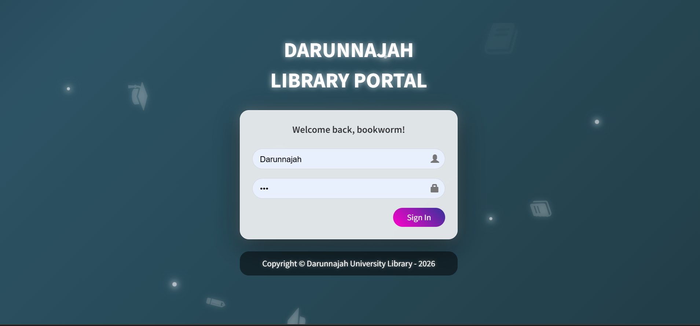

# library-darunnajah

## ❓ Kenapa Websitenya Nggak Bisa Langsung Dipakai Pak?

tuk halaman statis HTML,CSS,JS aja. Makanya, halaman yang lagi Bapak buka sekarang ini cuma bisa jadi pameran visual alias pajangan saja.

penasaran banget pengen coba fiturnya, kodenya open source tuh. langsung clone bae, terus running lokal di laptop masing-masing pake XAMPP. Dijamin lancar jaya asal tau caranya sih.(kalau belum bisa tanya aja sama Nevanda pak karna dia yang bantu saya dan karna orang paling jago se fakultas saintek tapi IPK nya sengaja dikecilin, kocak emang, tanya saya langsung juga bisa pak, karna saya anak didik dia, gk mungkin developer gk faham jalanin project sendiri)

Oh iya misal mau coba login jadi Admin
* **User : Darunnajah
* **Sandi: 123

Ya sebenernya masih banyak user lain tapi saya sertakan dua aja, tapi silahkan di cek sendiri nanti di dalam, lagian kan bisa di tambah atau dikurangi seenak kita kalau login jadi admin.

---

*Catatan: Source code dikembangkan dan dimodifikasi oleh Haila dengan penuh kegembiraan.*
