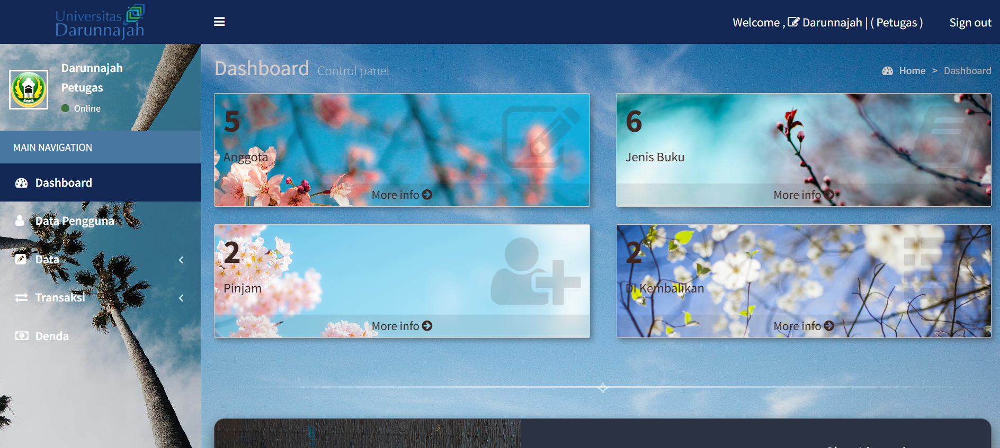
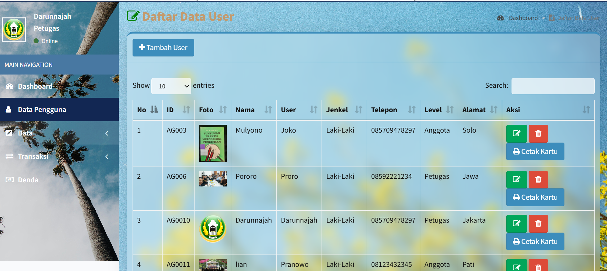
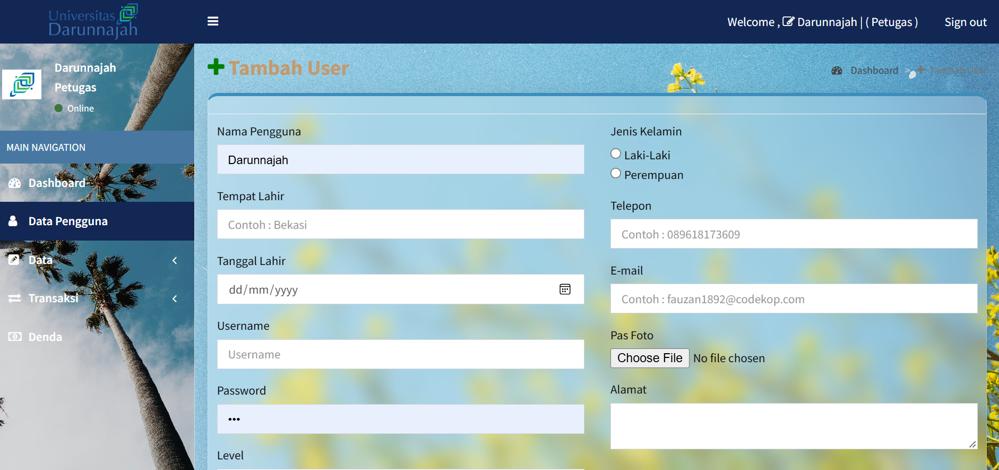
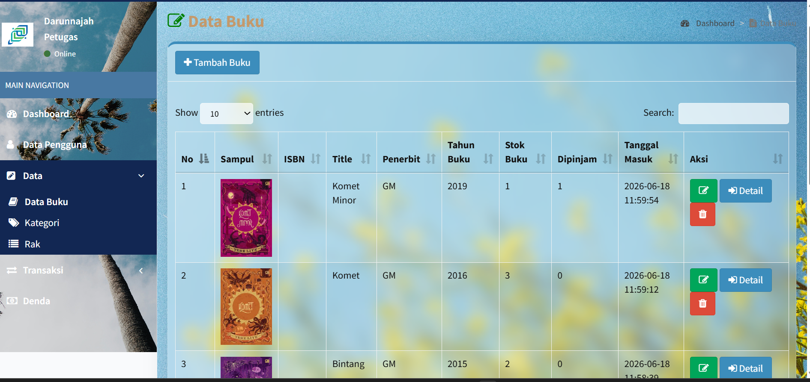
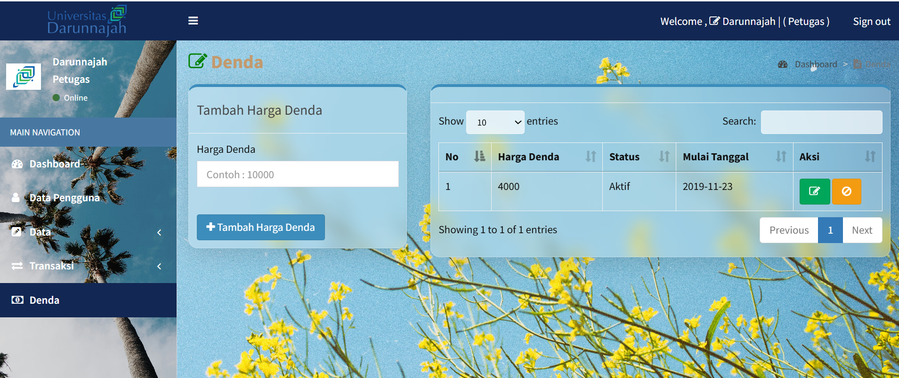

# library-darunnajah

Oh iya misal mau coba login jadi Admin
* **User : Darunnajah
* **Sandi: 123

Ya sebenernya masih banyak user lain tapi saya sertakan dua aja, tapi silahkan di cek sendiri nanti di dalam, lagian kan bisa di tambah atau dikurangi seenak kita kalau login jadi admin.

---

*Catatan: Source code dikembangkan dan dimodifikasi oleh Haila dengan penuh kegembiraan.*
